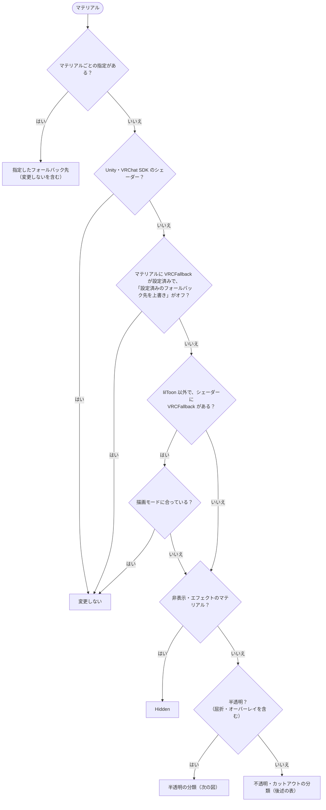
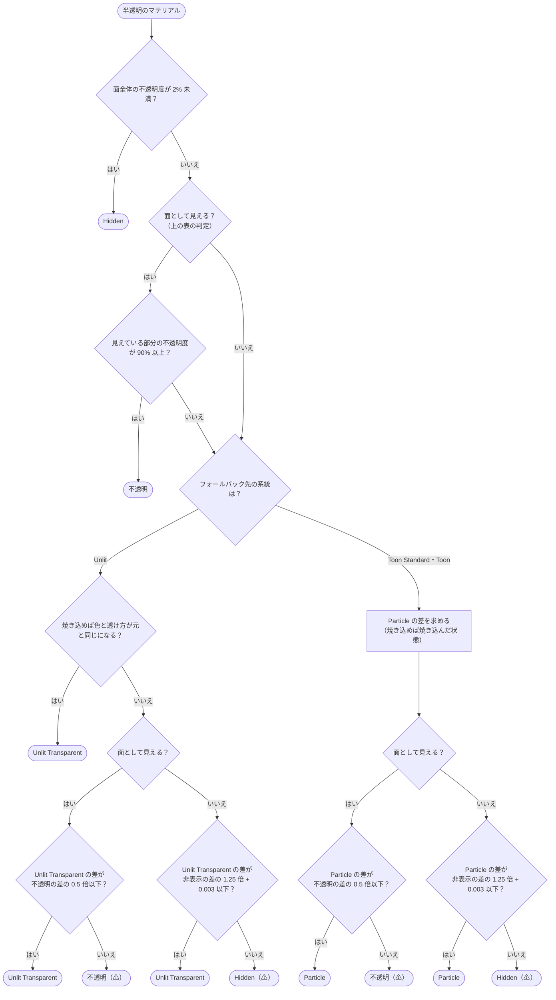

# フォールバック先の分類

[トップページ](../../README.md) > [TAO Optimize VRC Shader Fallback](README.md) > フォールバック先の分類

マテリアルごとに、フォールバック先をどう決めるかを説明します。

## 決め方の全体

マテリアルごとの指定がないときは、次の順に判定し、最初に当てはまったものを使います。

- **非表示・エフェクトのマテリアル**: lilToon の「非表示」、FakeShadow・輪郭線のみ・ファーのみのシェーダー、加算などのエフェクト、パーティクルやトレイルだけで使われるマテリアルです。
- **描画モードに合っている**: 半透明（エフェクトを含む）のマテリアルは、VRCFallback が Fade・Transparent・Particle・Hidden などの半透明向けのとき。抜けのあるカットアウトは、VRCFallback がカットアウト向けのとき。不透明のマテリアルは、変更しません（カットアウトで VRCFallback が不透明向けの場合を除きます）。詳しくは [lilToon 以外のシェーダー](#liltoon-以外のシェーダー) を参照してください。

## フォールバック先の系統

光の影響を受けるもの（Toon Standard・Toon・Standard）と、光の影響を受けないもの（Unlit）を、1 つのマテリアルの中で混ぜないようにしています。両方を混ぜると、暗い場所で一部だけ光って見えるためです。

| 基本のフォールバック先 | 不透明 | カットアウト（抜けあり） | 半透明 |
|---|---|---|---|
| Toon Standard | Toon Standard、または輪郭線の条件を満たすとき Toon Standard Outline | Toon Cutout | Particle・不透明・Hidden のどれか |
| Toon | Toon（両面描画は ToonDoubleSided） | Toon Cutout | Particle・不透明・Hidden のどれか |
| Unlit | Unlit | Unlit Cutout | Unlit Transparent・不透明・Hidden のどれか |

lilToon で、光の影響を受けない設定（「Unlit 化」が 0.5 以上、または「明るさの下限」が 0.9 以上）のマテリアルは、基本のフォールバック先にかかわらず、Unlit の系統にします。

## 半透明マテリアルの分類

### 面として見えるか

半透明のマテリアルは、透け感のある衣類のように「面」として見えるものと、顔の透明なマテリアルや眼鏡のレンズのように「重ねて表示する」ものに分けます。

| 順 | 条件 | 判定 |
|---|---|---|
| 1 | lilToon のオーバーレイ・屈折のシェーダー、または顔のメッシュ（リップシンクとまばたきに使うメッシュ）のマテリアル | 重ねて表示 |
| 2 | 体（頭・首・目・顎を除く Humanoid ボーン）に付いている部分が半分以上 | 見えている部分の不透明度が 10% 以上なら面 |
| 3 | そのほか | ZWrite が有効で、見えている部分の不透明度が 50% 以上なら面 |
| 補足 | メッシュの使われ方を読み取れない | ZWrite が有効で、色のアルファが 50% 以上なら面 |

「見えている部分の不透明度」は、色のアルファ・メインテクスチャのアルファ・アルファマスクから計算し、メッシュが使っている範囲を面積で平均した値です。「面全体の不透明度」は、そこに抜けている部分の割合を掛けたものです。

### 判定の流れ

「差」は、元の表示との差です（次の節）。

### 元の表示との差

- 候補のフォールバック先を、暗い・中間・明るい 3 種類の背景の上で描画し、元の表示と比べます。差は 0 に近いほど元の表示に近いことを表します。
- 背景は分からないので、3 つの平均で比べます。顔に重ねるもの（顔の透明なマテリアルなど）は後ろが肌なので、明るい背景の重みを大きくします（中間 25%、明るい 75%）。
- 焼き込みで元と同じ色・透け方になる場合は、焼き込んだ状態の差を使います。焼き込めない場合は、焼き込まない状態の差を使います。
- 「不透明の差」は、抜けのあるマテリアルではカットアウトの差になります。

### 比べ方

| 系統 | 面として見える | 重ねて表示 |
|---|---|---|
| Toon Standard・Toon | Particle の差が不透明の差の 0.5 倍以下なら **Particle**。そのほかは **不透明**（⚠） | Particle の差が非表示の差の 1.25 倍 + 0.003 以下なら **Particle**。そのほかは **Hidden**（⚠） |
| Unlit | 焼き込みで同じになるなら、または Unlit Transparent の差が不透明の差の 0.5 倍以下なら **Unlit Transparent**。そのほかは **不透明**（⚠） | 焼き込みで同じになるなら、または Unlit Transparent の差が非表示の差の 1.25 倍 + 0.003 以下なら **Unlit Transparent**。そのほかは **Hidden**（⚠） |

Particle は、下の色を暗くする乗算でしか表せません。明るい色の布を Particle にすると、布が消えたように見えます。そのため、面として見えるものは、Particle のほうがはっきり元に近いときだけ Particle にします。

### 例（作者の検証より）

| 例 | Toon Standard（基本） | Unlit（基本） |
|---|---|---|
| 明るい色の透ける衣類（ワンピースなど） | Particleよりも元の表示に近いため不透明（⚠） | Unlit Transparent |
| 顔に重ねる透明なマテリアル | Particle | Unlit Transparent |
| ほとんど見えていないマテリアル（面全体の不透明度が 2% 未満） | Hidden | Hidden |

### 警告（⚠）と補足（ⓘ）

- **⚠**: 見た目が大きく変わる可能性があるものです。透け感を表せず不透明にした、表示できず Hidden にした、などが該当します。
- **ⓘ**: そのほかの補足です。焼き込みの状況や、設定の意味などを示します。

## 不透明・カットアウトのマテリアル

| 基本のフォールバック先 | 条件 | フォールバック先 |
|---|---|---|
| Toon Standard | 抜けている部分が面積の 25% 以上あり、体に付いていない | Toon Cutout |
| Toon Standard | 輪郭線の条件を満たす（下記） | Toon Standard Outline |
| Toon Standard | そのほか | Toon Standard |
| Toon | 裏面だけを描画する | Hidden |
| Toon | 抜けている部分がある | Toon Cutout（両面描画は ToonCutoutDoubleSided） |
| Toon | そのほか | Toon（両面描画は ToonDoubleSided） |
| Unlit | 抜けている部分がある | Unlit Cutout |
| Unlit | そのほか | Unlit |

- **両面描画**: Toon Standard は、元のカリングの設定を引き継ぎます。Unlit は両面描画に対応していないため、表の面だけが表示されます。
- **輪郭線の条件**（Toon Standard Outline）: lilToon のマテリアルで、輪郭線の太さが 0 より大きく、頂点カラーで太さを変えず、太さのマスクの平均が 0.5 以上であること。輪郭線の色の設定が「暗い色だけ」のときは、色の明るさ（リニアの輝度）が 0.15 以下であること。
- Toon Standard の輪郭線は光の影響を受けないため、明るい色の輪郭線は暗い場所で光って見えます。「暗い色だけ」は、この見え方を避けるための設定です。

## lilToon 以外のシェーダー

- 描画モードは、Standard と同じ慣習（RenderType、Render Queue、`_Mode`、`_SrcBlend`・`_DstBlend`、キーワード）から読み取ります。
- 不透明度は、`_Color` のアルファとメインテクスチャのアルファから測ります。Poiyomi のアルファマスクは読み取れないため、不透明度には反映されません（ⓘ で通知します）。
- 影（Shadow Ramp）と輪郭線の再現、焼き込みは、lilToon だけが対象です。

**シェーダー自体に VRCFallback が書かれているもの**（Poiyomi は `Standard`）は、マテリアルに VRCFallback が設定されていない限り、そのシェーダーのすべてのマテリアルが同じフォールバック先になります。そこで、次のように扱います。

- 描画モードに合っているマテリアルは、変更しません。不透明なマテリアルは、シェーダーの設定のまま表示されます。
- 描画モードに合っていないマテリアルだけを、シェーダーの系統に合わせて決め直します。

| シェーダーの VRCFallback | 抜けのあるカットアウト | 半透明 |
|---|---|---|
| `Standard`（Poiyomi など） | Standard Cutout | 半透明の分類に従い、Standard Fade（Src Blend が One のときは Standard Transparent）、不透明、または Hidden |
| `Unlit` | Unlit Cutout | 半透明の分類に従い、Unlit Transparent、不透明、または Hidden |
| `Toon` | Toon Cutout | 半透明の分類に従い、Particle、不透明、または Hidden |
| そのほか（`Particle`・`Hidden` など） | 変更しません | 変更しません |

加算などのエフェクトは、系統にかかわらず Hidden にします（エフェクト用の VRCFallback が書かれたシェーダーを除きます）。

## Standard 系

Standard 系は、Unity の Standard シェーダーへのフォールバックです。メインテクスチャや色など、Standard と同じ名前の値が引き継がれます。

| 種類 | 描画 | 使われる場面 |
|---|---|---|
| Standard | 不透明 | 手動で指定したとき、またはシェーダーの VRCFallback が Standard のとき |
| Standard Cutout | 抜けのあるカットアウト | 同上 |
| Standard Fade | 半透明（Src Alpha で合成） | 同上 |
| Standard Transparent | 半透明（乗算済みアルファで合成） | 同上 |

- **自動では、lilToon のマテリアルに選びません。** Standard は光の当たり方が lilToon や Toon Standard と違い、ほかの部分と明るさが合わないことがあるためです。
- lilToon のマテリアルに指定した場合は、つやのない見た目になるように、光沢の値（`_Glossiness` など）を設定します。
- 合成の設定（Src Blend）が One のマテリアルは、乗算済みアルファで合成するため Standard Transparent が近くなります。Src Alpha のマテリアルは Standard Fade が近くなります。指定したフォールバック先と合成の設定が合わないときは、補足で案内します。
- Standard 系の見た目は、VRChat が引き継ぐ値に依存します。実機での確認はしていません（[動作確認の状況](values-and-limits.md#動作確認の状況)）。
